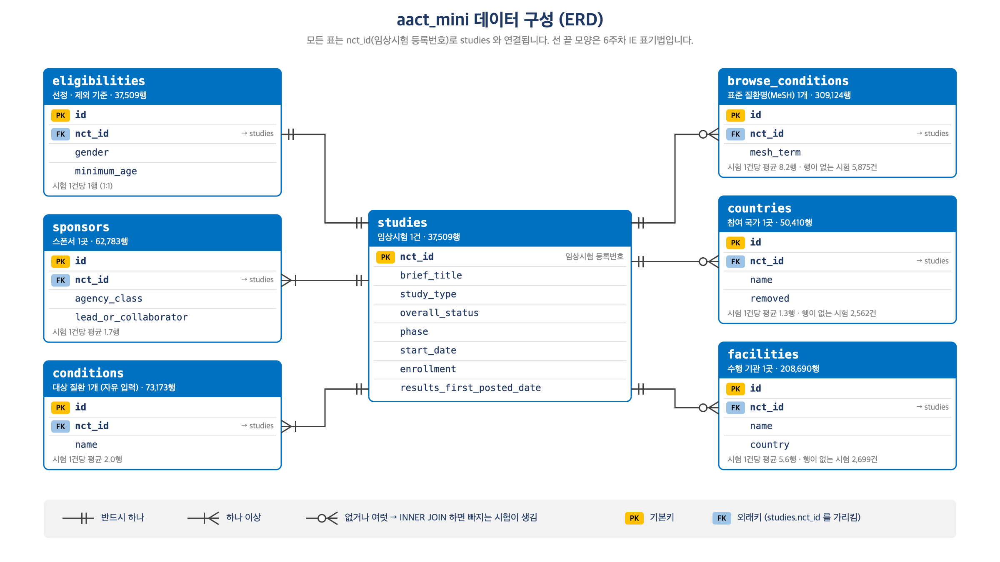

# 데이터베이스 관리 — 실습 자료 (2026)

보건대학원 「데이터베이스 관리」 수업의 실습 노트북과 데이터입니다.
ClinicalTrials.gov 임상시험 등록 자료(AACT)에서 2015~2024년 시작 시험 37,509건을 추린 수업용 DB(`aact_mini`)를 사용합니다.

## 바로 실행 (Google Colab)

아래 배지를 누르면 Colab에서 노트북이 열립니다. **준비 셀**을 실행하면 데이터(약 50MB)를 자동으로 내려받습니다. 과제는 맨 위 칸에 학번과 이름을 먼저 입력합니다.

| <sub>주차</sub> | <sub>구분</sub> | <sub>내용</sub> | Colab |
|---|---|---|---|
| <sub>7주차</sub> | <sub>실습</sub> | <sub>SQL (1) 조회 기초 — SELECT · WHERE · ORDER BY</sub> | [](https://colab.research.google.com/github/kevinkwshin/medical-db-course-2026/blob/main/notebooks/07_실습_SQL기초.ipynb) |
| <sub>8주차</sub> | <sub>실습</sub> | <sub>SQL (2) 집계 · GROUP BY · JOIN</sub> | [](https://colab.research.google.com/github/kevinkwshin/medical-db-course-2026/blob/main/notebooks/08_실습_집계와JOIN.ipynb) |
| <sub>9주차</sub> | <sub>실습</sub> | <sub>질문을 SQL로 바꾸기 · 서브쿼리</sub> | [](https://colab.research.google.com/github/kevinkwshin/medical-db-course-2026/blob/main/notebooks/09_실습_질문을SQL로.ipynb) |
| <sub>9주차</sub> | <sub>**과제 1**</sub> | <sub>일반적인 SQL 사용법 — 잘못된 SQL 12개 고치기 (조회 · 집계 · JOIN) · 해석 · **제출기한 2026-11-10(화)**</sub> | [](https://colab.research.google.com/github/kevinkwshin/medical-db-course-2026/blob/main/notebooks/과제1.ipynb) |
| <sub>10주차</sub> | <sub>실습</sub> | <sub>데이터 수정 · 트랜잭션 · 뷰</sub> | [](https://colab.research.google.com/github/kevinkwshin/medical-db-course-2026/blob/main/notebooks/10_실습_데이터수정.ipynb) |
| <sub>12주차</sub> | <sub>실습</sub> | <sub>데이터에서 나오는 오류 찾기</sub> | [](https://colab.research.google.com/github/kevinkwshin/medical-db-course-2026/blob/main/notebooks/12_실습_오류찾기.ipynb) |
| <sub>13주차</sub> | <sub>**과제 2**</sub> | <sub>당뇨병 임상시험 분석 — 변수 찾기 → 표 연결 → 통계 · 결과표 · 해석 · **제출기한 2026-12-08(화)**</sub> | [](https://colab.research.google.com/github/kevinkwshin/medical-db-course-2026/blob/main/notebooks/과제2.ipynb) |

> Colab 배지를 **새 창**으로 열려면 배지에서 **마우스 오른쪽 버튼 → 새 창에서 링크 열기**를 누르세요.
>
> 작성한 내용을 저장하려면 Colab 메뉴 **File → Save a copy in Drive** 를 먼저 눌러 주세요. 과제 제출 파일은 **File → Download → Download .ipynb** 로 받습니다.

## 데이터 구성

모든 표는 `nct_id`(임상시험 등록번호)로 `studies` 와 연결됩니다. `studies` 의 기본키는 `nct_id`, 나머지 표의 기본키는 `id` 이고, 각 표의 `nct_id` 는 `studies.nct_id` 를 가리키는 외래키입니다.



## 폴더 구성

| 경로 | 내용 |
|---|---|
| `notebooks/` | 학생용 실습 · 과제 노트북 |
| `data/aact_mini.duckdb.gz` | 수업용 DB (압축본, 노트북이 자동으로 풀어 사용) |
| `data/aact_mini_dictionary.md` | 데이터 사전 (테이블 · 컬럼 설명) |
| `data/aact_mini_erd.png` | 데이터 구성도 (`tools/build_erd.py` 로 생성) |
| `tools/` | 슬라이드 · 노트북 생성 도구 (교수자용) |

## 내 컴퓨터에서 실행

```bash
pip install "duckdb==1.4.5" "jupysql==0.11.1" "duckdb-engine==0.17.0" pandas
gunzip -k data/aact_mini.duckdb.gz
jupyter notebook notebooks/
```

## 데이터 출처 — AACT 와 aact_mini

**AACT (Aggregate Analysis of ClinicalTrials.gov)** 는 Clinical Trials Transformation Initiative(CTTI)가 ClinicalTrials.gov 등록 자료 전체를 관계형 데이터베이스로 정리해 매일 공개하는 자료입니다.

| 항목 | 링크 |
|---|---|
| AACT 홈페이지 | <https://aact.ctti-clinicaltrials.org/> |
| 내려받기 (무료 회원가입 후 로그인) | <https://aact.ctti-clinicaltrials.org/snapshots> → **Flat Text Files** (파이프 `\|` 로 구분한 텍스트 파일 묶음, zip) |

### aact_mini 추출 기준

| 기준 | 내용 |
|---|---|
| 원본 | AACT 스냅샷 (Flat Text Files, 표 49개, 약 2.5GB). 추출일 2026-09-19 |
| 대상 시험 | 시작일(`start_date`)이 **2015-01-01 ~ 2024-12-31** 인 임상시험 |
| 표본 | 위에서부터 자르거나 무작위로 뽑지 않음. 등록번호(`nct_id`)를 DuckDB `hash()` 로 숫자로 바꾸고, **100 으로 나눈 나머지가 0~7** 인 시험만 남김 (`hash(nct_id) % 100 < 8` → 100건 중 약 8건 = **약 8%**). 표의 순서와 상관없이 등록번호만으로 정해지므로 다시 만들어도 같은 시험이 뽑힘 |
| 추가 표본 | 자주 쓰는 질환 15개(제2형 당뇨병 · 고혈압 · 천식 등, MeSH 기준)는 나머지가 **0~29** 인 시험까지 남김 (`< 30` → **약 30%**). 시험 수를 넉넉하게 하려는 것 |
| 결과 | **37,509건** |
| 표 | 49개 중 수업에 쓰는 **14개**만 사용. 모두 `nct_id` 로 `studies` 와 연결 |
| 열 | 표마다 수업에 필요한 열만 사용 (예: `studies` 는 30개 열) |
| 정리 | 빈칸 → NULL, 긴 글의 줄바꿈 기호 `~` → 줄바꿈으로 복원, 선정 · 제외 기준 글은 앞 1,500자만 |

다시 만들 때 (교수자용):

```bash
python3 tools/build_aact_mini.py --snapshot data/<내려받은_파일>.zip
```

> aact_mini 는 **표본**이므로 건수 · 비율이 ClinicalTrials.gov 전체와 다릅니다. 수업에서 나오는 숫자는 이 표본 기준입니다.
